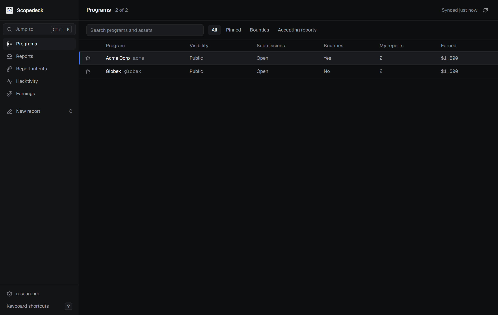
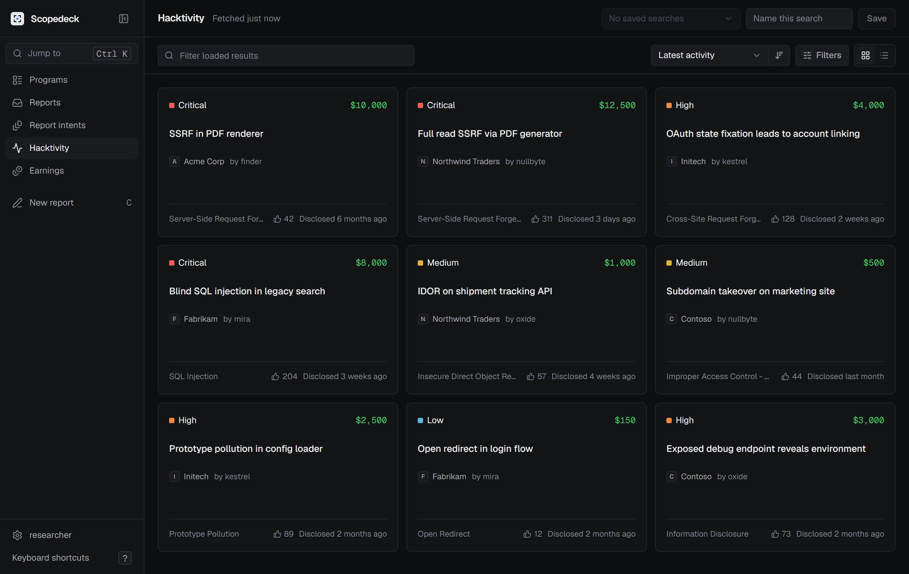
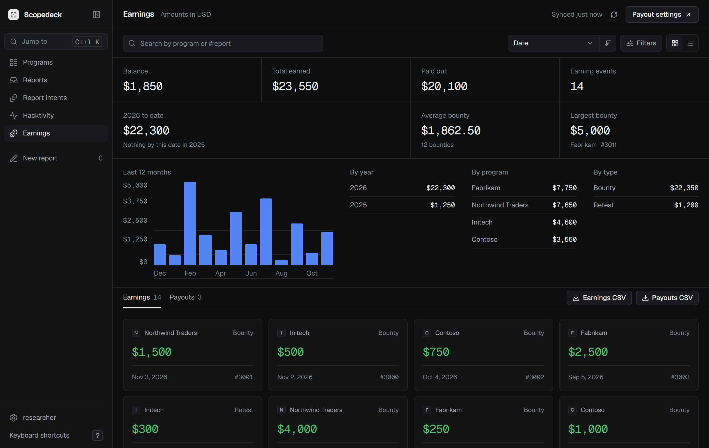

# Scopedeck

A fast desktop client for the [HackerOne Hacker API](https://api.hackerone.com/hacker-resources/).
Browse programs and scope offline, write reports in a real editor, track your inbox and
earnings, and search Hacktivity, all from one window.



> Scopedeck is an independent open-source project. It is not affiliated with, endorsed by or
> sponsored by HackerOne. "HackerOne" is a trademark of its owner and is used here only to
> describe the API this app talks to.

## Features

- **Programs.** Full-text search across every program and asset you can access, pinned
  programs, and a "new" badge on scope that changed since your last sync. Export scope as JSON
  or a plain asset list.
- **Composer.** Pick an eligible asset, weakness and severity, write in a split Markdown editor
  with live preview, tick off the program's exclusions, and review the exact JSON payload before
  submitting. Drafts autosave locally. Reusable templates.
- **Finding import.** Drop a JSON file that follows the
  [published schema](docs/finding-import.md) and Scopedeck fills the draft, flagging anything it
  could not match against the program's scope or weaknesses.
- **Report intents.** For programs that support them, submit through an intent and watch it
  move from pending to ready.
- **Reports.** An inbox with state, severity and bounty columns, the full activity timeline, and
  opt-in desktop notifications when something changes.
- **Hacktivity.** A query builder that compiles to the API's Lucene syntax, a raw query mode,
  saved searches and infinite scroll.
- **Earnings.** Balance, monthly totals, per-program breakdown and CSV export.
- **Keyboard first.** <kbd>Ctrl</kbd>/<kbd>⌘</kbd>+<kbd>K</kbd> palette, `g`-sequences for
  navigation, `j`/`k` in every table. Press <kbd>?</kbd> for the full list.

Anything the API does not cover, such as replying to a report or changing account settings,
opens the right page on hackerone.com. [docs/api-coverage.md](docs/api-coverage.md) lists what
is implemented and what is linked out.

| Composer                                   | Report                                 |
| ------------------------------------------ | -------------------------------------- |
|  |  |

| Hacktivity                                     | Earnings                                   |
| ---------------------------------------------- | ------------------------------------------ |
|  |  |

## Install

Download the installer for your platform from the
[latest release](https://github.com/BankkRoll/scopedeck/releases/latest):

| Platform | File                                |
| -------- | ----------------------------------- |
| macOS    | `Scopedeck_<version>_universal.dmg` |
| Windows  | `Scopedeck_<version>_x64-setup.exe` |
| Linux    | `.AppImage`, `.deb` or `.rpm`       |

Releases are signed. **Settings → Check for updates** fetches the release manifest, and an
update installs only when you confirm it and its signature verifies.

### Connect your account

1. Create an API token on hackerone.com under **Settings → API token**.
2. Open Scopedeck and enter your HackerOne username and the token.

Scopedeck verifies the token with one read request and stores it in your operating system's
keychain.

## Security model

- **The token never reaches the UI.** All HTTP runs in the Rust core. The web view can only call
  named commands, and none of them return the token.
- **The token lives in the OS keychain** (macOS Keychain, Windows Credential Manager, Secret
  Service on Linux). It is never written to disk, logs or the local cache.
- **Logs are redacted.** The token and the derived `Authorization` value are scrubbed from every
  log line and error message. A test captures trace-level output, the SQLite cache and every
  command response and asserts the token appears in none of them.
- **Locked-down web view.** A strict Content Security Policy, no remote scripts, and a capability
  set that only allows listening for app events. File pickers and save dialogs run in Rust, so
  the UI never supplies a file path.
- **Sanitized Markdown.** Report and policy Markdown is rendered with a strict allowlist. Images
  and raw HTML are stripped, and links open externally only when they point at hackerone.com.
- **Nothing is sent anywhere else.** The only network peers are `api.hackerone.com` and, for
  updates, GitHub Releases.

Signing out deletes the keychain entry and the local cache. Report vulnerabilities in Scopedeck
itself as described in [SECURITY.md](SECURITY.md).

## Build from source

Requirements: Node 22 (see `.nvmrc`), pnpm 10, and the Rust toolchain pinned in
`rust-toolchain.toml`. On Linux, install the
[Tauri system dependencies](https://v2.tauri.app/start/prerequisites/#linux).

```sh
pnpm install
pnpm tauri dev      # run the app
pnpm tauri build    # build an installer for this platform
```

See [CONTRIBUTING.md](CONTRIBUTING.md) for the test and lint commands, and
[docs/architecture.md](docs/architecture.md) for how the pieces fit together.

## License

[MIT](LICENSE)
