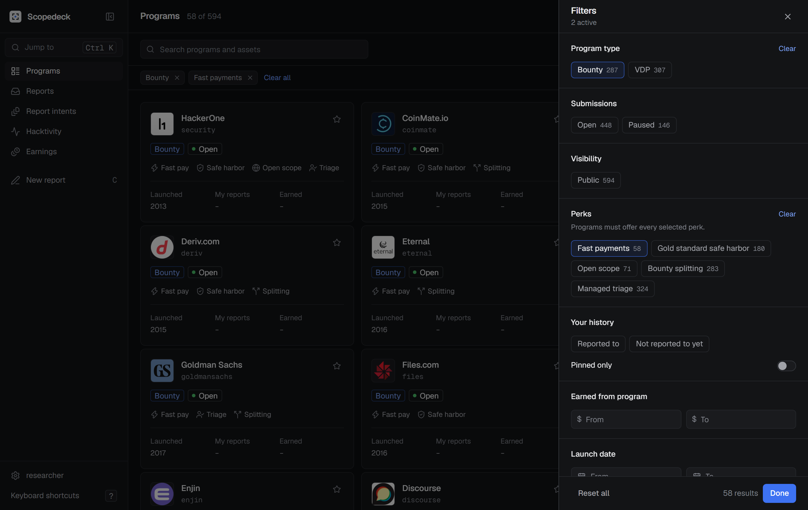
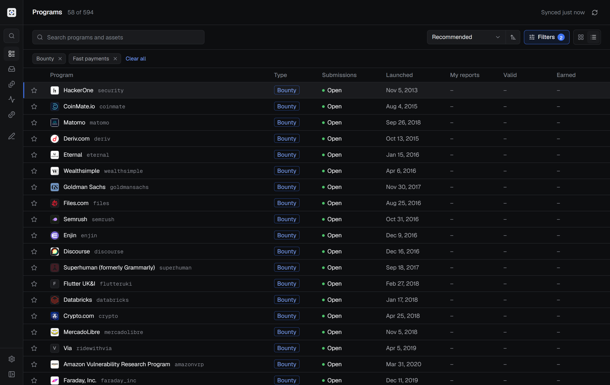
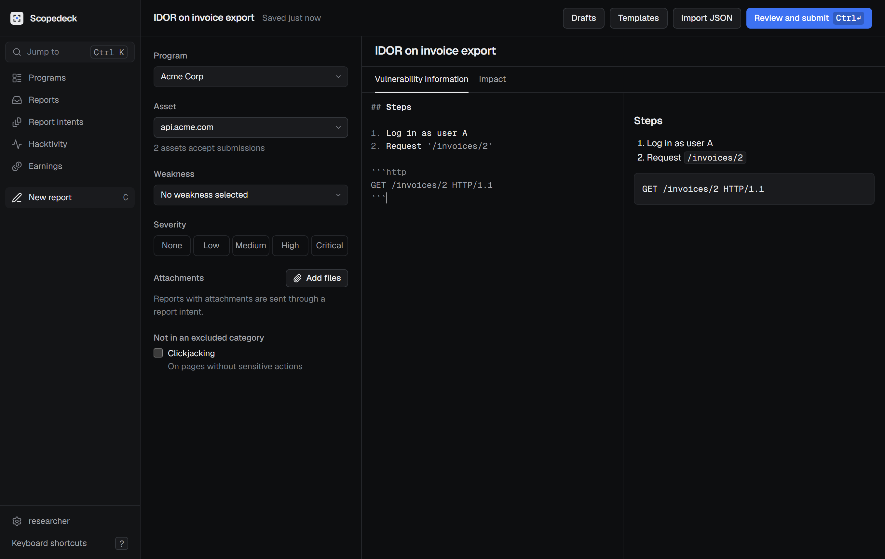
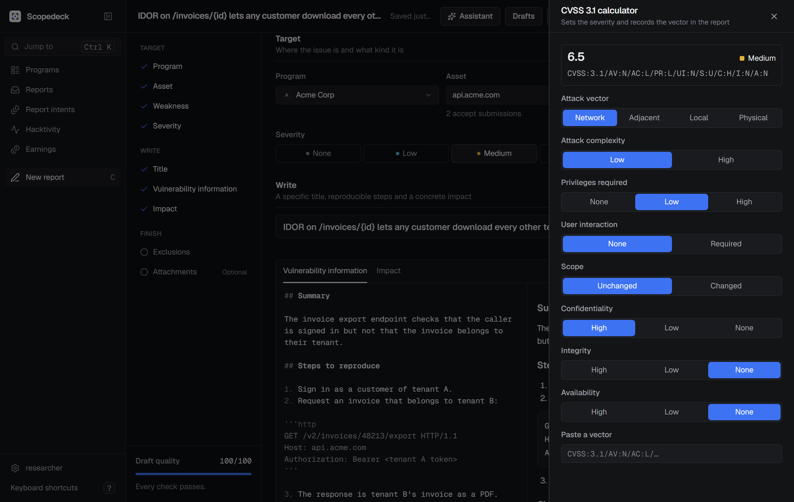
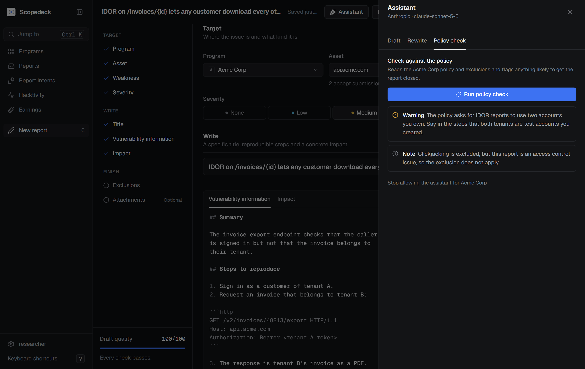
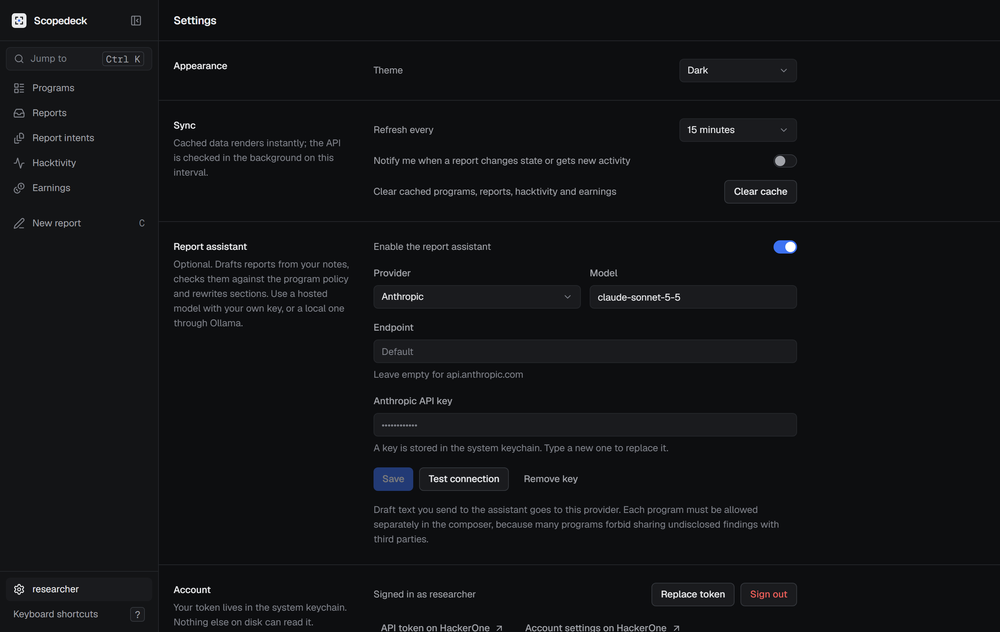
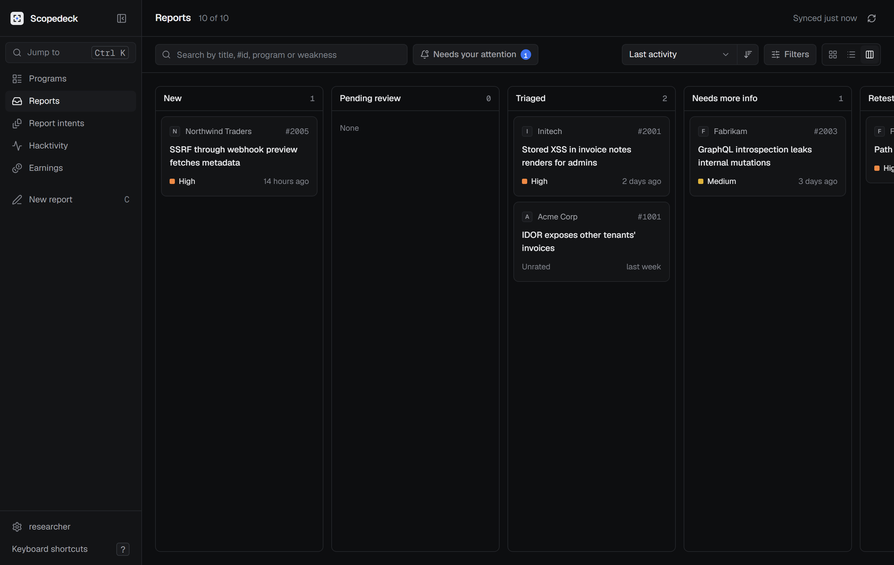
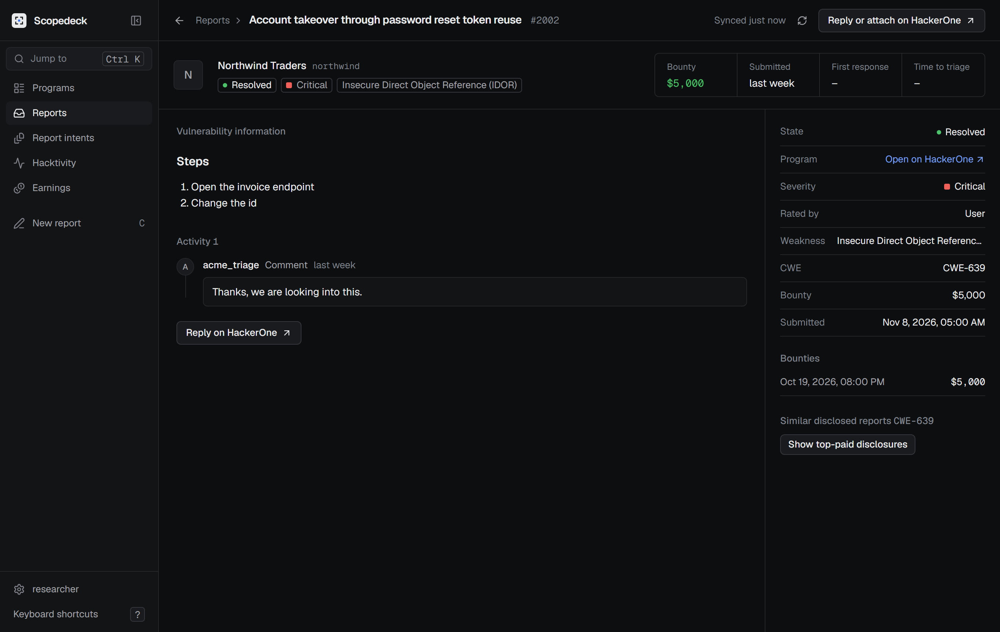
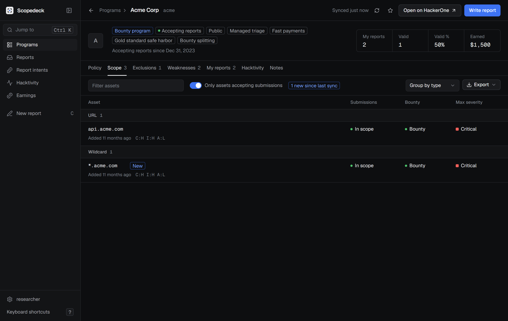
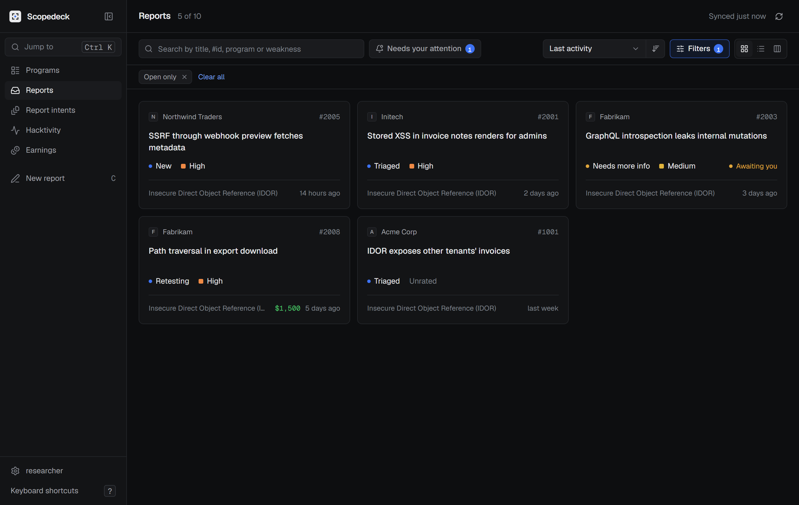

# Scopedeck

A fast desktop client for the [HackerOne Hacker API](https://api.hackerone.com/hacker-resources/).
Browse programs and scope offline, write reports in a real editor, track your inbox and
earnings, and search Hacktivity, all from one window.


> Scopedeck is an independent open-source project. It is not affiliated with, endorsed by or
> sponsored by HackerOne. "HackerOne" is a trademark of its owner and is used here only to
> describe the API this app talks to.

## Features

- **Programs.** Full-text search across every program and asset you can access, pinned
  programs, and a "new" badge on scope that changed since your last sync. Export scope for your
  tools: hosts, wildcards, URLs, CIDR ranges, a Burp Suite scope file or a Nuclei target list.
  Each program page opens on its policy and has tabs for scope (with added dates and CIA
  requirements), exclusions, weaknesses, your reports there, its disclosed Hacktivity, and private,
  local-only notes.
- **Composer.** A guided flow from target to submission: a step rail that shows what is left, a
  draft quality score with concrete hints, a CVSS 3.1 calculator that sets the severity and
  records the vector, and per-weakness starter templates. Write in a split Markdown editor with
  live preview, tick off the program's exclusions, and review the exact JSON payload before
  submitting. Drafts autosave locally.
- **Report assistant (optional, off by default).** Draft a report from rough notes, get title
  ideas, tighten or restructure a section, and check the draft against the program policy. Bring
  your own Anthropic or OpenAI key, or run a local model through Ollama. Hosted providers must be
  allowed per program, and nothing is applied until you accept it.
- **Finding import.** Drop a JSON file that follows the
  [published schema](docs/finding-import.md) and Scopedeck fills the draft, flagging anything it
  could not match against the program's scope or weaknesses.
- **Report intents.** For programs that support them, submit through an intent and watch it
  move from pending to ready.
- **Reports.** An inbox with cards, a list or a board by state, a "needs your attention" filter
  for reports waiting on you, the full activity timeline, response and triage times, the CVSS
  vector, top-paid disclosures for the same weakness, and opt-in desktop notifications.
- **Hacktivity.** Report summaries and time to disclosure in a details panel, a query builder that compiles to the API's Lucene syntax, a raw query mode,
  saved searches and infinite scroll.
- **Earnings.** Balance, year to date against last year, average and largest bounty, monthly
  totals, breakdowns by program and type, and CSV export.
- **One toolbar everywhere.** Every page has search, sort, a filter sheet with live result
  counts, removable filter chips, and a card or list layout. Your choices are remembered per page.
- **Keyboard first.** <kbd>Ctrl</kbd>/<kbd>⌘</kbd>+<kbd>K</kbd> palette, `g`-sequences for
  navigation, `j`/`k` in every table, <kbd>Ctrl</kbd>/<kbd>⌘</kbd>+<kbd>B</kbd> to collapse the
  sidebar. Press <kbd>?</kbd> for the full list.

Anything the API does not cover, such as replying to a report or changing account settings,
opens the right page on hackerone.com. [docs/api-coverage.md](docs/api-coverage.md) lists what
is implemented and what is linked out.

| Filters                                  | List view, collapsed sidebar                     |
| ---------------------------------------- | ------------------------------------------------ |
|  |  |

| Composer                                   | CVSS calculator                             |
| ------------------------------------------ | ------------------------------------------- |
|  |  |

| Report assistant                             | Assistant settings                         |
| -------------------------------------------- | ------------------------------------------ |
|  |  |

| Reports board                                        | Report                                 |
| ---------------------------------------------------- | -------------------------------------- |
|  |  |

| Program                                  | Reports                                  |
| ---------------------------------------- | ---------------------------------------- |
|  |  |

| Hacktivity                                     | Earnings                                   |
| ---------------------------------------------- | ------------------------------------------ |
|  |  |

Screenshots use the public program list and made-up demo data, so they show no real account's
reports or earnings.

## Install

Download the installer for your platform from the
[latest release](https://github.com/BankkRoll/scopedeck/releases/latest):

| Platform | File                                |
| -------- | ----------------------------------- |
| macOS    | `Scopedeck_<version>_universal.dmg` |
| Windows  | `Scopedeck_<version>_x64-setup.exe` |
| Linux    | `.AppImage`, `.deb` or `.rpm`       |

Releases are signed. **Settings → Check for updates** fetches the release manifest, and an
update installs only when you confirm it and its signature verifies.

On Windows, Setup installs for your account only, so it needs no administrator rights. Running it
again updates or reinstalls in place and keeps your sign-in, drafts and settings; an MSI install
from 0.1.2 or earlier is removed and replaced. To uninstall, use **Settings → Apps**. Your data is
kept unless you tick **Also remove my data**, which also deletes the API token and AI key from
Windows Credential Manager. Scripted installs can use `/S` (silent) and `/P` (passive).

### Connect your account

1. Create an API token on hackerone.com under **Settings → API token**.
2. Open Scopedeck and enter your HackerOne username and the token.

Scopedeck verifies the token with one read request and stores it in your operating system's
keychain.

## Security model

- **The token never reaches the UI.** All HTTP runs in the Rust core. The web view can only call
  named commands, and none of them return the token.
- **The token lives in the OS keychain** (macOS Keychain, Windows Credential Manager, Secret
  Service on Linux). It is never written to disk, logs or the local cache.
- **Logs are redacted.** The token and the derived `Authorization` value are scrubbed from every
  log line and error message. A test captures trace-level output, the SQLite cache and every
  command response and asserts the token appears in none of them.
- **Locked-down web view.** A strict Content Security Policy, no remote scripts, and a capability
  set that only allows listening for app events. File pickers and save dialogs run in Rust, so
  the UI never supplies a file path.
- **Sanitized Markdown.** Report and policy Markdown is rendered with a strict allowlist. Images
  and raw HTML are stripped, and links open externally only when they point at hackerone.com.
- **Nothing is sent anywhere else.** The only network peers are `api.hackerone.com`,
  HackerOne's logo CDN (`profile-photos.hackerone-user-content.com`, images only, no
  credentials), GitHub Releases for updates, and, only if you turn the report assistant on, the
  AI provider you chose.
- **The assistant is opt-in twice.** It is off until you enable it, and a hosted provider must
  then be allowed for each program, because many programs forbid sharing undisclosed findings.
  The provider key lives in the keychain like the HackerOne token, and redirects are refused so
  the key cannot be forwarded to another host. Ollama runs locally and must be on loopback.

Signing out deletes the keychain entry and the local cache. Report vulnerabilities in Scopedeck
itself as described in [SECURITY.md](SECURITY.md).

## Build from source

Requirements: Node 22 (see `.nvmrc`), pnpm 10, and the Rust toolchain pinned in
`rust-toolchain.toml`. On Linux, install the
[Tauri system dependencies](https://v2.tauri.app/start/prerequisites/#linux).

```sh
pnpm install
pnpm tauri dev      # run the app
pnpm tauri build    # build an installer for this platform
```

See [CONTRIBUTING.md](CONTRIBUTING.md) for the test and lint commands, and
[docs/architecture.md](docs/architecture.md) for how the pieces fit together.

## License

[MIT](LICENSE)
