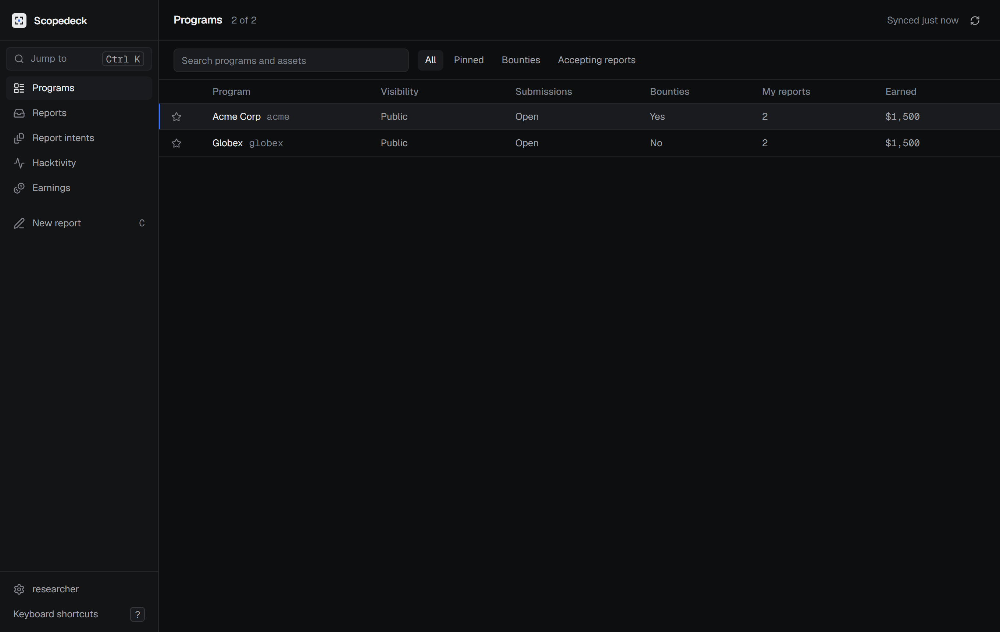

First public release of Scopedeck, a desktop client for the HackerOne Hacker API.

## Highlights

- **Programs**: search every program and asset offline, pin favourites, see what changed in scope since your last sync.
- **Composer**: searchable program, asset and weakness pickers, a split Markdown editor, an exclusions checklist, autosaved drafts, templates and JSON finding import.
- **Safe submit**: review the exact payload before anything is sent. Supports direct reports and report intents with attachments.
- **Reports**: inbox with state, severity and bounty, full activity timeline, opt-in desktop notifications.
- **Hacktivity**: query builder or raw Lucene, saved searches, infinite scroll.
- **Earnings**: balance, monthly chart, per-program totals, CSV export.

## Install

| Platform                        | Download                                        |
| ------------------------------- | ----------------------------------------------- |
| Windows                         | `Scopedeck_0.1.0_x64-setup.exe` (or the `.msi`) |
| macOS (Apple silicon and Intel) | `Scopedeck_0.1.0_universal.dmg`                 |
| Linux                           | `.AppImage`, `.deb` or `.rpm`                   |

Sign in with your HackerOne username and an API token from **Settings → API token** on hackerone.com.

> Installers are not yet signed with Apple or Microsoft certificates, so macOS Gatekeeper and Windows SmartScreen will warn on first launch. Updates are signed and verified.

## Security

Your token is stored in the OS keychain and never reaches the UI, the logs or the local cache. All requests go straight from your machine to `api.hackerone.com`.

---

Not affiliated with HackerOne.
