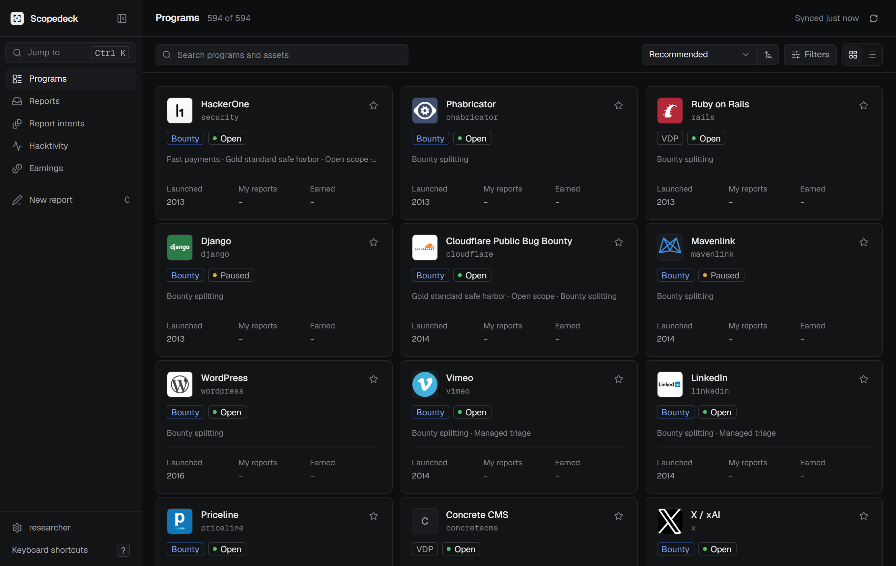

A redesign of every data page, plus fixes for real accounts.

## New

- **Cards or list on every page**: programs, reports, intents, Hacktivity and earnings. Cards are the default; your choice is remembered per page.
- **Filter sheet**: a right-hand panel with grouped filters, live result counts and removable chips under the toolbar.
- **Shared toolbar**: search, sort with a direction toggle, filters and layout, in the same place on every page.
- **Program logos** in lists, cards, pickers, the command palette and report pages.
- **Collapsible sidebar** (`Ctrl/⌘ + B`) with tooltips when collapsed.
- **Styled controls**: searchable pickers for programs, assets and weaknesses, plus custom dropdowns, checkboxes, switches and a date picker.
- **Program page header** with perks badges and your stats, a scope filter and per-asset copy.

## Fixed

- Program and report detail pages failed to load on real accounts.
- The sign-in form now asks for your HackerOne username instead of an unclear "token identifier".

## Install

| Platform                        | Download                                        |
| ------------------------------- | ----------------------------------------------- |
| Windows                         | `Scopedeck_0.1.1_x64-setup.exe` (or the `.msi`) |
| macOS (Apple silicon and Intel) | `Scopedeck_0.1.1_universal.dmg`                 |
| Linux                           | `.AppImage`, `.deb` or `.rpm`                   |

Already on 0.1.0? Use **Settings → Check for updates**.

> Installers are not yet signed with Apple or Microsoft certificates, so macOS Gatekeeper and Windows SmartScreen will warn on first launch. Updates are signed and verified.

---

Not affiliated with HackerOne.
