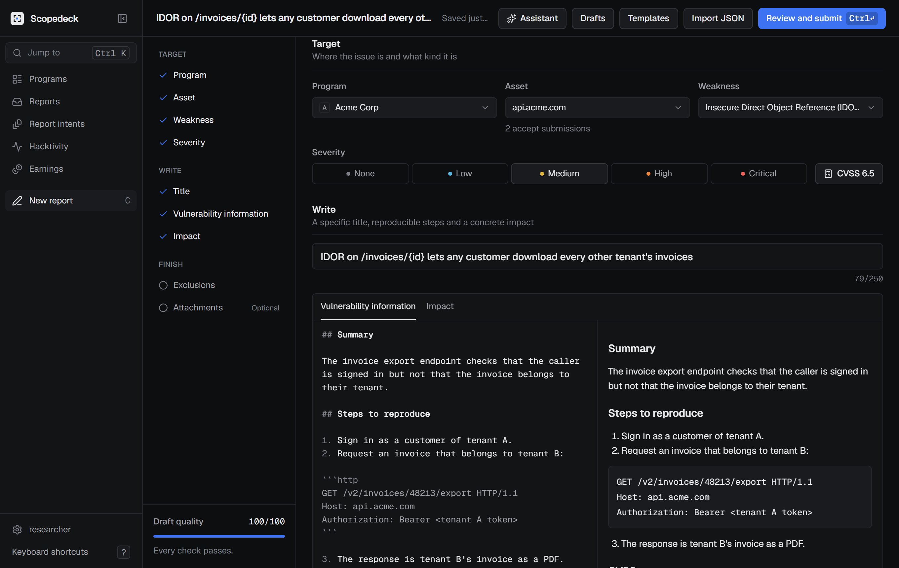

A guided composer, an optional report assistant, and recon-ready scope exports.

## New

- **Guided composer**: a step rail showing what is left, a draft quality score with concrete hints, and target pickers in one row.
- **CVSS 3.1 calculator**: scoring sets the severity and records the vector in the report.
- **Weakness templates**: start the body from a template matched to the chosen weakness.
- **Report assistant** (optional, off by default): draft from notes, title ideas, section rewrites and a policy check. Use your own Anthropic or OpenAI key, or a local model through Ollama. Hosted providers must be allowed per program, and nothing is applied until you accept it.
- **Scope export for tools**: hosts, wildcards, URLs, CIDR, a Burp Suite scope file and a Nuclei target list.
- **Reports board** grouped by state, and a **Needs your attention** filter for reports waiting on you.
- **Earnings insights**: year to date against last year, average and largest bounty, and totals by type.
- **Program notes**: private Markdown notes per program, stored only on your machine.

## Fixed

- The composer could reset while a picker was open, at the moment a new draft was first saved.

## Install

| Platform                        | Download                                        |
| ------------------------------- | ----------------------------------------------- |
| Windows                         | `Scopedeck_0.1.2_x64-setup.exe` (or the `.msi`) |
| macOS (Apple silicon and Intel) | `Scopedeck_0.1.2_universal.dmg`                 |
| Linux                           | `.AppImage`, `.deb` or `.rpm`                   |

Already installed? Use **Settings → Check for updates**.

> Installers are not yet signed with Apple or Microsoft certificates, so macOS Gatekeeper and Windows SmartScreen will warn on first launch. Updates are signed and verified.

---

Not affiliated with HackerOne.
