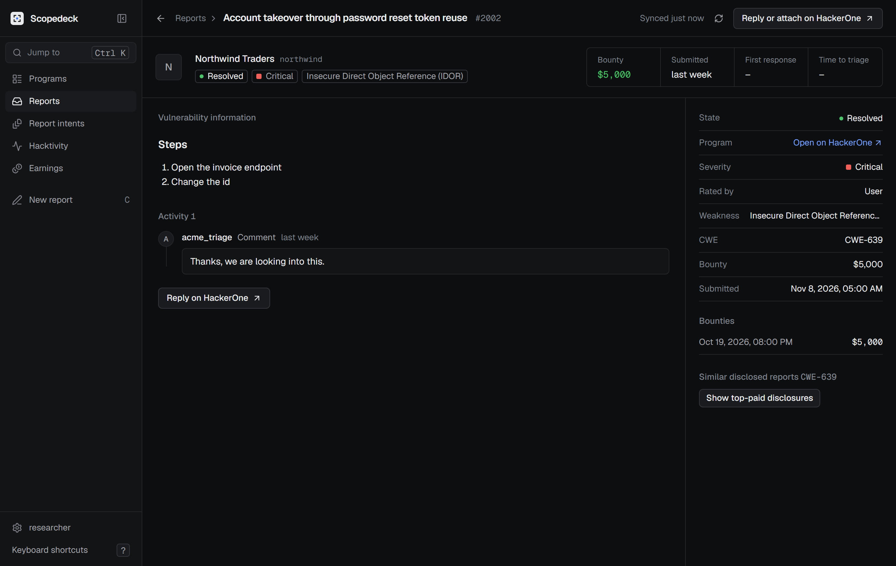

A custom Windows installer and uninstaller, and far more detail on every page.

## New

- **Windows Setup, redesigned.** One page that installs, updates or reinstalls in place, with the location and a desktop shortcut choice, then a finish page with Launch Scopedeck. It installs for your account only, so it needs no administrator rights. An MSI install from 0.1.2 or earlier is removed and replaced automatically.
- **A real uninstaller.** Says exactly what it removes. Your data is kept unless you tick **Also remove my data**, which also deletes the API token and AI key from Windows Credential Manager.
- **Back arrows and breadcrumbs** on program and report pages.
- **Report pages**: the program's logo and name, state, severity, bounty, time to first response and time to triage up top; avatars and Internal markers in the timeline; the CVSS vector; awarded amounts in your payout currency; and top-paid disclosures for the same weakness.
- **Program pages** open on the policy, and gain **My reports** and **Hacktivity** tabs, managed triage and join date, valid-report rate, scope added dates and CIA requirements, and weakness descriptions.
- **Hacktivity**: a details panel with the report summary, what happened last and time to disclosure; program names link inside the app.
- **Reports list**: an "Awaiting you" marker. **Report intents** show the program logo.
- **Composer** warns when the severity is above the asset's cap.

## Changed

- Windows releases ship as a single `.exe` installer; the `.msi` is gone.

## Install

| Platform                        | Download                        |
| ------------------------------- | ------------------------------- |
| Windows                         | `Scopedeck_0.1.3_x64-setup.exe` |
| macOS (Apple silicon and Intel) | `Scopedeck_0.1.3_universal.dmg` |
| Linux                           | `.AppImage`, `.deb` or `.rpm`   |

Already installed? Use **Settings → Check for updates**.

> Installers are not yet signed with Apple or Microsoft certificates, so macOS Gatekeeper and Windows SmartScreen will warn on first launch. Updates are signed and verified.

---

Not affiliated with HackerOne.
